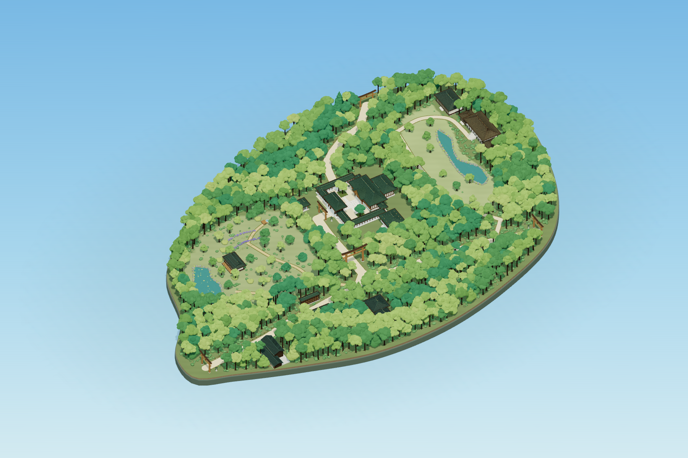

# 明治神宮 — A Forest in the Sun

**当前版本：v1.2.0**。东京明治神宫内苑的实时 WebGL 森林微缩世界：保留第一版精细神社建筑、树木美术与自由观察能力，并扩展为包含三个入口、参道、森林、御苑、南池、北部设施和宝物殿的完整园区场景。



[打开完整截图与视角索引](captures/forest-20261105/index.html) · [开发日志](docs/DEVELOPMENT_LOG.md) · [路线图](docs/ROADMAP.md) · [更新记录](CHANGELOG.md)

1,000 棵实体树木沿用第一版多边形树冠与三渲二美术语言，分为 23 个实例化空间块。完整范围参考官方地图；树位、边界、微地形及建筑细节是艺术近似，不是测绘模型。页面仍只有三维画布。

## 项目特色与技术

- **Three.js 0.187.0** 实时 WebGL 场景；程序化几何与材质，无需外部模型或运行时贴图。
- 保留主神社、南神门、围廊、木构与屋顶细节、鸟居，以及第一版的低多边形树冠和三渲二美术语言。
- 1,000 棵多形态树木、6,486 株灌木，按 23 个空间块实例化；提供近远树冠细节切换和轻微风动。
- 完整园区包含入口、路网、神社建筑区、御苑与南池、北部草地、宝物殿及附属设施，采用有来源的布局数据。
- 晴日浅蓝天空、方向明确的暖白日光、较冷环境补光与柔和投影；没有依赖强 Bloom、镜头光晕、浓雾或景深模糊。
- Vite 提供开发服务器与生产构建；Playwright 驱动本机 Chrome 完成浏览器验收。

## 打开

项目目录：`D:\Projects\MeijiJingu-Diorama`。双击 **Start.cmd**，或：

```powershell
cd D:\Projects\MeijiJingu-Diorama
npm ci
npm run dev
```

依赖已安装时可跳过 `npm ci`。默认服务地址为 <http://127.0.0.1:8787/>。

从 GitHub 获取：

```powershell
git clone https://github.com/KaoruMiyagawa/MeijiJingu-Diorama.git
cd MeijiJingu-Diorama
npm ci
npm run dev
```

- [完整森林园区](http://127.0.0.1:8787/?scene=precinct)
- [主神社近景](http://127.0.0.1:8787/?scene=precinct&view=6)
- [御苑近景](http://127.0.0.1:8787/?scene=precinct&view=7)
- [宝物殿与北池](http://127.0.0.1:8787/?scene=precinct&view=8)
- [真实 Chrome 截图评审页](http://127.0.0.1:8787/captures/forest-20261105/index.html)
- [保留的原核心区组合](http://127.0.0.1:8787/?scene=core)，使用当前晴日环境

`Start.cmd` 检查已有本地服务，必要时后台启动，再打开浏览器。日志在 `server.log` / `server-error.log`。

## 操作

| 输入 | 全园模式 |
| --- | --- |
| 左键拖动 / 单指拖动 | 旋转，保留惯性 |
| 滚轮 / 双指捏合 | 缩放 |
| 右键拖动 / 双指移动 | 平移 |
| `1` / `R` / `Home` | 完整园区全景 |
| `2` | 正上方俯视 |
| `3` | 南入口与南参道 |
| `4` | 北入口与北部园区 |
| `5` | 西北入口与西侧森林 |
| `6` | 主神社近景 |
| `7` | 御苑、隔云亭与南池 |
| `8` | 宝物殿与北池 |
| `9` | 奉纳酒樽与林间参道 |
| `0` | 反向全园全景 |

核心区模式的 `1–6` 继续使用第一版镜头。镜头切换保留 1.65 秒缓动，可被鼠标操作打断。URL 的 `&view=7` 可直接打开指定视角，`&time=0` 可固定动画时间而不冻结相机。系统启用减少动态效果时停止风动并立即切换镜头。

## 交付、截图与验证

- [本次交付记录、修改范围和已知限制](docs/FOREST-VISUAL-20261105.md)
- [截图索引](captures/forest-20261105/index.html)
- [本次验证与性能数据](captures/forest-20261105/verification.json)
- [带参考来源的实际布局数据](captures/forest-20261105/layout.json)

```powershell
npm run build
npm run capture:forest
npm test
node scripts/create-forest-review.mjs
```

验证使用已安装的 Chrome，通过临时本地端口测试生产 `dist/`，完成后关闭测试服务。包含基线哈希、路网、植被避让、实际西门开口、近远细节、鼠标与触控操作、镜头过渡、竖屏、帧间隔和核心区同镜头检查。所有截图均为实际浏览器输出，没有 AI 生成图。

生产预览可运行 `npm run preview`，地址 <http://127.0.0.1:8788/>。`dist/` 可由普通静态 HTTP 服务器运行，应通过 HTTP 打开，不能依赖双击 `dist/index.html`。截图评审页保存在项目的 `captures/` 中，不包含在独立 `dist/` 运行包内。

## 主要模块

| 文件 | 用途 |
| --- | --- |
| `src/main.js` | 场景选择、动画循环、URL 镜头与诊断 |
| `src/data/precinct-layout.js` | 有来源的园区边界、地标、区域和路网 |
| `src/scene/precinct.js` | 全园场景组装、原建筑挂载、全园镜头 |
| `src/scene/woodland.js` | 多层植被、空间分块、实例化、微风和近远细节 |
| `src/scene/park-spatial.js` | 植被位置筛选、道路/建筑/水域避让 |
| `src/scene/park-landscape.js` | 随园区轮廓的底座、参道、庭园、池岸、菖蒲 |
| `src/scene/park-buildings.js` | 附属建筑、手水舍、奉纳桶架与石灯笼 |
| `src/scene/west-gate.js` | 全园派生模型的西侧通道及台阶 |
| `src/scene/heightfield.js` | 统一地面高度查询 |
| `src/scene/core-sample.js` | 原核心区完整组合 |
| `src/core/environment.js` | 晴日天空、上午日光、环境辐射、阴影 |
| `src/core/sunny-materials.js` | 保留基础材质之上的精修 |

第一版 `architecture.js`、`roofs.js`、`forest.js`、`terrain.js`、`props.js` 及基础 `materials.js` 源文件仍与快照一致。

## 备份与历史

- `baselines/v1-20261103.zip`：第一版可恢复备份，未覆盖，ZIP 与快照文件均校验通过。
- `baselines/v1-20261103/SHA256.json`：第一版 43 个文件的哈希清单。
- `baselines/round2-graybox-20261105.zip`：本次开发前的灰盒代码与构建快照。
- `MeijiJingu-Diorama-delivery.zip`：原第一版交付包，未覆盖。
- `docs/ROUND-2-VISUAL-PLAN.md`、`docs/ROUND-2-BATCH-1.md` 和 `captures/round2/`：此前规划与灰盒批次的历史记录。

原始 ZIP 和完整第一版副本只保留在开发机，不上传 GitHub；仓库保留第一版文件 SHA256 清单和当前版本所需源码。需要恢复备份时，将本机 ZIP 解压到新目录，执行 `npm ci` 后使用空闲端口启动，例如 `npm run dev -- --port 8790`。旧 `scripts/verify.mjs`、`scripts/verify-round2.mjs` 和 `capture:round2` 对应历史场景，不作为当前验收入口。

## 表现边界

默认画质优先，本机验证为 Chrome + RTX 5060 Laptop；尚未实测真实手机或集显。帧间隔含显示调度，不是单独 GPU 时间。近景细叶、视角和阴影会影响提交量，不能直接将默认全景数据用于其他设备。

自由观察时树冠会自然遮挡建筑；没有树冠自动透明。水面有天空环境响应和微小法线动画，没有实时场景镜像反射。微缩比例、地形和附属建筑细节仍为艺术演绎。没有使用 Bloom、镜头光晕、雾或景深掩盖模型。

全部运行几何和纹理在本地生成，不依赖在线模型或贴图。官方照片仅用于本地研究；参考来源和许可证见 `THIRD-PARTY.md` 与本次交付记录。
